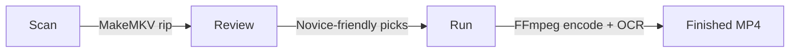

# bluray-to-mp4

<p align="center"><em>Turn your Blu-ray and DVD discs into high-quality MP4s—no technical expertise required.</em></p>

<p align="center">[Windows x64] [NVENC Optimized] [Private Use]</p>

> [!IMPORTANT]
> **Private Use Only:** This tool is for personal backups of discs you own. Keep the tool and its
> output private; circumvention law varies by jurisdiction.

A novice-friendly Windows desktop app that turns Blu-ray and DVD discs you
own into MP4 files, private and personal-use only. Insert a disc, press
Scan, review what it picked, press Start. You never need to learn what a
"PGS stream" is: the app recommends which tracks to keep with plain-English
reasons, and every recommendation has a dropdown you can override.

**Current version: v0.2.36** (Windows x64, exe included)

## Quick start

1. Download `bluray-to-mp4-windows-x64.zip` from the
   [latest release](../../releases) and extract it anywhere
   (e.g. `C:\Tools\bluray-to-mp4`)
2. **Trust the Publisher:** Right-click `install-cert.ps1` in the app
   folder $\rightarrow$ "Run with PowerShell". ✅ *Windows will no longer show "Unknown Publisher" warnings.*
3. Install [MakeMKV](https://www.makemkv.com/download/) with a current key
   (the app drives its command-line engine)
4. Insert a disc
5. Run `bluray-to-mp4.exe`, pick the drive, press **Scan**. ✅ *You should see a list of titles and recommended tracks.*
6. On the **Review** page, check the recommended audio and subtitle picks;
   use the dropdowns to change any of them.
7. Press **Start**. ✅ *The Encode page will show live progress and ETAs.*

Stuck? → [Troubleshooting](#-troubleshooting)

## The workflow

**Scan.** MakeMKV reads the disc's table of contents (decryption included).
The app shows every title, audio track, and subtitle track, and marks its
recommendations: best English audio (commentary and descriptive tracks
excluded), plain English subtitles over SDH/forced/foreign, and main feature
vs series episodes detected automatically.

**Review.** Every Recommended cell is a dropdown (v0.2.15). The audio
dropdown lists every audio stream with novice-friendly labels (language,
codec, channels, `[commentary]` markers); the subtitle dropdown leads with
`(no subtitles)` and lists every subtitle stream with `[SDH]` / `[forced]`
markers. When the scan cannot positively confirm a subtitle is English, the
pick is flagged with a warning sign and an "English not confirmed" note so
you can check it yourself. Picks are per-title and reset on a fresh scan.

**Run.** Rip (MakeMKV) then encode (ffmpeg). Blu-ray targets **~2 GB/hour at
1080p HEVC**; DVD targets **1.0 GB/hour at native SD resolution**. When AI
upscaling is enabled for DVD content, the target increases to **1.5 GB/hour** to
accommodate the higher-fidelity 720p result. Audio is AAC 5.1.
Encoding uses NVIDIA NVENC fast mode when a GPU and compatible driver are
present, x265 software quality mode otherwise. Interlaced sources are
deinterlaced.

## 📦 Output Targets
The app automatically optimizes settings based on the disc type:

| Disc Type | Target Resolution | Target Size | Audio / Subs |
|---|---|---|---|
| **Blu-ray** | 1080p HEVC | ~2 GB / hour | AAC 5.1 / Embedded OCR |
| **DVD** | Native SD | ~1.0 GB / hour | AAC 5.1 / Embedded OCR |
| **DVD (AI Upscale)** | 720p HEVC | ~1.5 GB / hour | AAC 5.1 / Embedded OCR |

> [!TIP]
> **NVENC Fast Mode:** If an NVIDIA GPU is detected, the app uses hardware acceleration to speed up encoding by ~10x.

**Subtitles.** Image-based subtitles (PGS on Blu-ray, VobSub on DVD) are
OCR'd to text by the bundled Subtitle Edit. The result is embedded **inside
the MP4** as a soft `mov_text` track (v0.2.16), the only subtitle form every
player (VLC, Plex, Jellyfin, Apple TV) reads from `.mp4`. The editable
sidecar `.srt` is kept next to the file either way. The embed mux writes to
a temp sibling and atomically replaces the MP4, so a failed mux can never
destroy the finished encode; the run records a warning and ships the MP4.
The run notes include an honest OCR-quality line (`OCR quality: X% of Y
cues clean ...`; v0.2.30), and a `<movie>.ocr` folder next to the MP4 keeps
the raw pass-1 SRT plus the extracted subtitle track (capped at 150 MB) so
OCR accuracy can be re-tuned offline without re-ripping the disc — that
folder is safe to delete.

**Series discs.** Episodes are named `Show Name - S01E05 - Episode Title.mp4`
with season and starting-episode controls. With a free TMDB key pasted into
the app, episode titles and movie years autofill
(`Movie Title (2019).mp4`). Without a key, names are entered manually and
everything still works offline.

**Done.** The History page records each output with its size and achieved
GB/hour, so every run self-grades against the size target.

## ⚙️ How it works
Get from disc to MP4 in a few simple steps:



### Honest validation status (2026-10-04)

- **Validated on real discs** (10-run validation day, v0.2.6 through
  v0.2.16): Blu-ray scan/rip/encode chain, PGS extraction and OCR to SRT,
  DVD video encode at the SD budget, live progress and ETAs, LAN monitoring
  during runs, rip reuse.
- **Runs 12 and 13 happened (2026-10-04):** OCR still required babysitting
  (the packaged app bundled SE's GUI, which has no unattended mode) -
  root-caused and replaced with the bundled headless seconv + Tesseract
  in v0.2.27. The run-13 progressive audio desync was root-caused too
  (hardcoded 29.97 fps stamp on a 23.976 rip) and is fixed by the real-fps
  probe plus the mezzanine duration gate (v0.2.27). Since v0.2.28 the
  live-action 720p profile runs the bundled, verified RealESRGAN_x2plus.
- **v0.2.34 (2026-10-18):** the Mamma Mia HWA redo probe caught both
  container rate fields lying uniformly (29.97 on a soft-telecined
  23.976 film). The DVD AI upscale now derives its stamp rate from
  decode truth (frames / measured audio duration, snapped to a canonical
  rate, refusing anything that snaps to nothing) and a restored clock
  gate re-verifies the mezzanine's playback duration against the shipped
  audio - so the redo's mezzanine will be stamped 23.976 and stay in
  sync. First field verification is tonight's redo run.
- **Remaining field-unverified item:** Windows-native OCR end-to-end
  (seconv + bundled Tesseract have not yet run on a real disc in the
  packaged app; scheduled for tonight's run).

## Rip reuse and resilience

The app was hardened by a 10-run real-disc validation day. The operational
lessons are built in:

- **Leftover rips are reused, not re-ripped.** A cancelled or killed run
  can leave a fully ripped `.mkv` in the workdir. Before ripping each
  title, the app duration-verifies the leftover with ffprobe **and** checks
  its resolution against the current scan (a DVD pressing and a Blu-ray of
  the same movie share a runtime but not a width). Verified rips move
  straight to encoding; corrupt or partial leftovers are deleted and
  re-ripped.
- **Clean starts.** The `.rip` workdir is purged of unexpected files at run
  start, so an old partial can never trigger MakeMKV's interactive
  overwrite prompt (which hangs forever in robot mode).
- **Orphaned MakeMKV detection.** A leftover `makemkvcon` process holding
  the drive used to freeze the drive list forever. The Setup check now
  names the cause and the fix (end it in Task Manager), and drive listing
  has a 60-second timeout that kills the orphan instead of leaking it.
- **MakeMKV 2.0.0 compatibility.** Disc-internal files (`.mpls` playlists)
  are filtered out of rip outputs, and a complete rip is recovered even
  when MakeMKV skips its "titles saved" summary line.
- **Cancel anywhere.** Cancel stops gracefully per progress line; a cancel
  mid-encode terminates ffmpeg before falling back to harder stops.

## Live progress everywhere

- Animated activity dots and an elapsed clock on every job
- Per-stage percent and ETA, streamed during scan, rip, encode, and OCR
- A total-remaining forecast across **all** steps in the header pill
  (v0.2.14/v0.2.16): the current stage's measured ETA plus forecast time
  for every stage still ahead, replaced by measured ETAs as stages start

## History

The History page records each finished output with duration, file size, and
achieved GB/hour, so you can spot-check the size target without opening a
calculator. (History is in-memory for this session; persistence is on the
roadmap.)

## Remote monitoring

A read-only HTTP status server ships **on by default** (`0.0.0.0:8765`),
token-gated. The "LAN monitoring" checkbox on the main screen starts/stops
it live and remembers your choice; the header shows the LAN URL when on.

```
curl -H "Authorization: Bearer <token>" http://<windows-pc>:8765/status
curl -H "Authorization: Bearer <token>" http://<windows-pc>:8765/history
curl http://<windows-pc>:8765/health        # token-free liveness ping
```

The default token is in `bluray_to_mp4/config.py`; override it in
`%USERPROFILE%\.bluray-to-mp4\config.json`. Windows Firewall will prompt on
first launch; allow it on private networks. The server is strictly
read-only: it reports progress and can never trigger rips, encodes, or
setting changes.

## Requirements

- **Windows x64**
- **An optical drive** with the disc you are backing up
- **MakeMKV** installed, with a current key
  ([makemkv.com/download](https://www.makemkv.com/download/)). Free while in
  beta: the beta key expires roughly monthly. When it does, the app tells
  you; grab the current key from the
  [MakeMKV forum](https://www.makemkv.com/forum/viewtopic.php?f=5) and
  register it in MakeMKV GUI. A purchased key is permanent.
- **NVIDIA GPU** (optional): enables NVENC fast mode, roughly 10x faster
  than software. Without one, the app falls back to x265 quality mode
  automatically.
- **TMDB API key** (optional): a free
  [Developer key](https://www.themoviedb.org/settings/api) autofills
  episode titles and movie years. Lookups fail soft; offline or a bad key
  means a warning, never a failed run.

### Bundled tools (packaged builds)

The zip bundles everything else the pipeline needs:

- **ffmpeg n8.1 + ffprobe** (gyan.dev-style static build, compiled against
  NVENC SDK 13.0 so it works on NVIDIA driver 590+; v0.2.2 bundles them,
  v0.2.4 fixed the SDK/driver match)
- **Subtitle Edit 5.2.0 seconv** (headless OCR converter for image
  subtitles; the GUI bundle was replaced in v0.2.27 because the SE 5.x
  GUI has no unattended mode - it opened the interactive OCR wizard on
  every run) plus a **bundled Tesseract 5.5.3 with the English model**,
  so unattended OCR needs zero extra installs

Packaged builds prefer their bundled tools over anything on PATH (v0.2.2:
a system ffmpeg without NVENC was shadowing ours). From-source installs
search environment overrides (`B2M_MAKEMKVCON`, `B2M_FFMPEG`,
`B2M_FFPROBE`, `B2M_SUBTITLE_EDIT`) then PATH then standard install
folders; the in-app Setup check shows exactly what was found.

## Signing and trust

Builds are code-signed with **YetiWurks LLC**'s own certificate (a two-cert
chain: code-signing cert issued by the YetiWurks Root CA), with an RFC3161
timestamp. It is not a paid public CA, so Windows warns about an unknown
publisher until you opt in to trusting YetiWurks builds. The bundled
`install-cert.ps1` is that opt-in: run it once per PC (it self-elevates)
and the exe runs without warnings, showing **YetiWurks LLC** as publisher.
Every CI build is signature-verified before packaging.

## CLI (same engine)

```
bluray-to-mp4 drives                     # list optical drives + loaded discs
bluray-to-mp4 scan 0                     # analyze disc 0, show recommendations
bluray-to-mp4 run 0 --out "D:\Movies" --dry-run    # preview the full plan
bluray-to-mp4 run 0 --out "D:\Movies"    # rip + encode for real
bluray-to-mp4 run 0 --out "D:\Movies" --dvd-upscale 720p    # DVD-only AI upscale
bluray-to-mp4 probe-stream 0             # experimental: stream-from-disc
                                         # investigation (v0.2.17, in progress)
```

Series override when the disc label is unhelpful:

```
bluray-to-mp4 run 0 --out "D:\TV" --series-name "Breaking Bad" --season 1 --start-episode 5
```

Force an encoder with `--encoder nvenc` or `--encoder x265` (default: auto).

## Troubleshooting

| Symptom | Likely cause | Fix |
|---|---|---|
| "Evaluation period has expired" | MakeMKV beta key expired | Get the current key from the [forum](https://www.makemkv.com/forum/viewtopic.php?f=5) and register it in MakeMKV. |
| Drive list spins / Setup times out | Orphaned `makemkvcon` process | Open Task Manager and end all `makemkvcon` tasks. |
| No subtitles in the MP4 | OCR failed or skipped | Check the run log. If OCR failed, the MP4 is still saved, but subs are missing. |
| Encode is very slow | No NVIDIA GPU detected | The app is using x265 software mode. Update drivers or use a GPU-enabled PC. |

Full guide → [docs/troubleshooting.md](docs/troubleshooting.md)

## Development

```
pip install -e ".[dev]"
pytest
```

The full pipeline is testable offline: `run_pipeline(..., dry_run=True)`
plans everything against fixture MakeMKV output without touching discs,
makemkvcon, or ffmpeg. The suite covers the parser, recommendations, series
detection, encode args, SRT handling, binary discovery, UI flows (offscreen
Qt), and the monitoring API.

Docs: [BUILD.md](BUILD.md) (exe packaging + CI),
[DEVELOPMENT.md](DEVELOPMENT.md) (design decisions + dev log),
[CHANGELOG.md](CHANGELOG.md).

## Roadmap

Under consideration, awaiting Eric's OK (from the 2026-10-02 improvement
audit): automatic orphan-makemkvcon detection with a fix banner, a
movie/series manual override on the Review page (covers hybrid discs the
duration heuristic misclassifies), and persistent history that survives app
restarts.

In progress:

- **v0.2.17:** stream-from-disc for Blu-ray via MakeMKV's stream server
  (the experimental `probe-stream` CLI command is the current investigation)
- **v0.2.18:** DVD direct-read via a CI-built `ffmpeg-css.exe`

## License

Private repository; all rights reserved.
